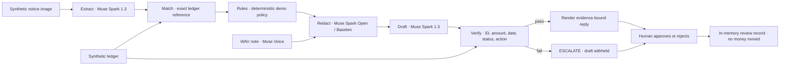

# PayOps Brain

**Read a dispute. Ground the recommendation. Keep a human in charge.**

A local payments-operations demo built from scratch for the Meta Global AI
Developer Hackathon. A synthetic notice image enters a LangGraph workflow. The
agent extracts fields, matches ledger records, applies demo policy, redacts draft
context, proposes structured claims, and verifies them before showing an
evidence-bound reply. An operator approves or rejects every recommendation.
**No payment is executed.**

## Run locally

Python 3.11+ and Node.js 20.19+ or 22.12+ required. Generated synthetic data is
already committed. Start two terminals:

```powershell
# Terminal 1, repository root
python -m venv .venv
.\.venv\Scripts\python.exe -m pip install -r requirements.txt
Copy-Item .env.example .env
# Keep keys blank for offline mode. PAYOPS_MOCK=true forces it.
.\.venv\Scripts\python.exe -m uvicorn backend.main:app --host 127.0.0.1 --port 8000
```

```powershell
# Terminal 2
cd frontend
npm.cmd ci
npm.cmd run dev
```

Open **http://127.0.0.1:5173**. API docs: http://127.0.0.1:8000/docs.
On macOS/Linux use `.venv/bin/python` and `npm`. `npm.cmd` avoids PowerShell's
script-execution restriction on `npm.ps1`.

Choose D001 (rotated duplicate-debit notice), optionally record/upload a voice
note, then click **Run agent**. Inspect the redaction comparison, cited ledger
records, verifier and draft. **Inject bad citation** tests a copy; it does not
change the original run. Approve or reject the actual recommendation. Reviewed
cases close for the session. Restart the backend to reset the queue.

## Architecture



Each graph step appears in the trace with its configured model or local
implementation, mode, status, duration and output summary. This is an execution
audit, not a model chain-of-thought display. Voice attribution appears when the
stored transcript is used unchanged in the run.

## Models and real API setup

| Step | Intended real model | Transport | Offline behavior |
|---|---|---|---|
| Extract | `muse-spark-1.3` | Meta Responses, image data URL | Reads fixture sidecar; no OCR |
| Redact | `meta-models/muse-spark-open-1026` | Baseten Chat Completions | Local identity/pattern scrub |
| Draft | `muse-spark-1.3` | Meta Responses | Deterministic claims and confidence fixture |
| Voice | `muse-voice-transcribe-1.0` | Meta HTTP multipart | Fixed transcript; ignores speech content |
| Match, rules, verify | Python | Local functions | Same implementation |

The saved [live evaluation](eval_results_live.md) records extraction, redaction
and drafting with `muse-spark-1.3` through Meta Responses on 2026-11-04.
This run does not verify the Baseten open-weight model or real voice transcription.
HTTP request shapes are also covered by tests with stubbed transports.

Edit the ignored `.env` locally:

```dotenv
MODEL_API_KEY=your_meta_key
BASETEN_BASE_URL=your_dashboard_openai_compatible_base_url
BASETEN_API_KEY=your_baseten_key
PAYOPS_MOCK=false
```

Restart the backend after changing configuration. Never commit populated keys.
`EXTRACT_*`, `REDACT_*`, and `DRAFT_*` independently override `MODEL_MODEL`,
`MODEL_BASE_URL`, `MODEL_API_KEY`, and `MODEL_PROTOCOL`. Protocol values are
`responses` or `chat`; Meta defaults to Responses. When `BASETEN_BASE_URL` is set,
redaction defaults to Baseten's key, Chat and the requested `-1026` model.
Explicit `REDACT_*` overrides win. Without Baseten, redaction falls back to
`MODEL_*` and may use the closed Meta model; the trace shows this. Missing keys
make that step mock. `PAYOPS_MOCK=true` forces every step mock. Live errors never
silently fall back to fixtures.

**Model-ID discrepancy:** official public Meta/Baseten pages show
`meta-models/muse-spark-open`; the requested dashboard-specific `-1026` ID could
not be confirmed there. The app keeps `-1026` as requested. Verify the exact model
and base URL in your dashboard. See [API contract verification](docs/api_contracts.md)
for official sources and scope.

```powershell
# Offline text + image check
.\.venv\Scripts\python.exe scripts/check_api.py
# Requires real credentials; fails if any graph step is mock
.\.venv\Scripts\python.exe scripts/check_api.py --require-live --all
# Optionally test a real voice recording
.\.venv\Scripts\python.exe scripts/check_api.py --require-live --all --voice path/to/note.wav
```

Voice accepts mono 16-bit PCM WAV at 16 or 24 kHz, up to 120 seconds / 10 MB.
Browser recording converts captured audio to mono 24 kHz WAV. Uploaded files must
already be supported WAVs. Convert if needed:
`ffmpeg -i input.mp3 -ac 1 -ar 24000 -sample_fmt s16 note.wav`.
The microphone UI is implemented but was not exercised with a physical microphone
during this build; WAV upload was API-tested. Audio is not persisted by the app.

## What the verifier checks

The model produces **structured claims**, not arbitrary reply prose. A draft must
cite exactly the matched records without missing, extra or duplicate citations.
Each ID must exist and belong to the matched transaction. Amount, date and status
must match that record, and the action must match policy. Money uses decimal
arithmetic. Schema errors, provider failures or failed verification force
`ESCALATE`. Failed drafts are withheld from the rendered reply.

The reply is rendered from checked claims and a fixed policy reason, preventing
unsupported free-text assertions from bypassing verification. This cannot detect
false or incomplete ledger data. Valid citations do not alone prove correctness.

Demo policy: exactly two matching settled debits suggest `REFUND`; one settled
debit suggests `NO_ACTION`; refunded rows suggest `NO_ACTION`; failed-but-debited
rows suggest `REFUND`. Unknown references, amount/date conflicts, mixed statuses,
ambiguous multiplicity, future dates or age over 90 days escalate. The 0–90-day
window is invented demo policy, not a payment-network/legal rule. UPI/card/BIN
labels do not implement separate network-specific policies.

## Tests and evaluation

```powershell
.\.venv\Scripts\python.exe -m pytest
.\.venv\Scripts\python.exe scripts/smoke.py
.\.venv\Scripts\python.exe scripts/eval.py
cd frontend
npm.cmd run build
```

| Run | Action accuracy | Valid cited IDs | Full verifier passes | Escalations | Agent errors |
|---|---|---|---|---|---|
| [offline (fixtures)](eval_results.md) | 100.0% (30/30) | 100.0% (31/31) | 100.0% (30/30) | 12/30 | 0 |
| [live (Meta API, 2026-11-04 IST)](eval_results_live.md) | 100.0% (30/30) | 100.0% (31/31) | 100.0% (30/30) | 12/30 | 0 |

Both runs require human review for **30/30** cases. Tests cover adversarial
citations, provider failure paths, redaction and stale-run approval.
The saved live run used `muse-spark-1.3` for extraction, redaction and drafting;
it does not demonstrate the Baseten open-weight path.

**Offline evaluation is not model accuracy.** Extraction reads ground-truth
sidecar fields and drafting uses deterministic fixtures. Rotated, blurred and
low-contrast images exist, but offline results do not measure image robustness.
The live run uses real extraction and drafting over 30 synthetic notices with
synthetic policy labels. These numbers do not measure real-world performance.
`python scripts/eval.py --live` requires all graph model keys, makes provider calls
and saves [eval_results_live.md](eval_results_live.md) atomically after every
completed case, including failures. Offline runs similarly save `eval_results.md`.
Use `--limit 10 --workers 4` for a smaller concurrent run; the default is four
workers. Limits must allow at least three noisy images and multiple scenarios;
the first N cases are kept when they already satisfy that coverage. Otherwise,
the earliest cases meeting the coverage requirement are selected. HTTP 429 and
timeout failures retry up to three times with exponential backoff and jitter.
Partial reports contain only completed cases; their denominators and live caveat
reflect that count. Ctrl+C saves completed work and cancels queued cases; active
HTTP requests finish or time out. Regenerate fixtures with `python gen_data.py`,
then restart the API.

## What was built during the hackathon

Created from scratch in this session: configurable Meta/Baseten adapters;
LangGraph workflow; synthetic image/ledger generator; demo policies;
model-assisted redaction adapter; voice adapter and WAV upload; React queue and
case workspace; evidence trail; claim verifier; human approval/rejection with
stale-run protection; isolated bad-citation demo; tests, evaluation and a
[three-minute demo shot list](demo/script.md). Third-party libraries and model
services are dependencies, not work claimed as original. Submission eligibility
and timing must be checked by the entrant.

## Honest limitations

* Synthetic data only. Local and unauthenticated. State/review history is in memory
  and resets on restart; use one backend process. No database or durable audit
  log. Approve/reject records review, not a refund.
* Extraction sends the original image to Meta. Redaction receives original text
  and protects only later draft context. The trace displays original vs redacted
  synthetic values. Hosted Baseten is not private hosting. Open weights permit
  deployment options; private hosting is not implemented here.
* Redaction drops identity fields and scrubs known values, numeric and UPI/email
  patterns. Unrecognized names/unusual identifiers may survive. This is not a
  certified anonymizer. Do not use private data. Confidence scores are
  uncalibrated; mock scores are fixed fixtures, not probabilities.
* The saved live report verifies the Meta-model workflow on synthetic data only.
  Baseten's requested `-1026` model, live voice transcription and physical microphone
  behavior remain unverified. Browser/app automation was unavailable during build,
  so visual/browser interaction QA is outstanding; frontend compilation passed.
* No reconciliation, fraud scoring, routing, SAM integration, auth, database,
  deployment or automatic submission. Reconciliation, fraud and routing are
  future work only. A demo script is included; no video was recorded.

## API routes

`GET /health`, `GET /disputes`, `GET /disputes/{id}`, `GET /notices/{id}.png`,
`POST /disputes/{id}/run` (`{"note":"optional text"}`),
`POST /disputes/{id}/voice` (multipart `audio`),
`POST /disputes/{id}/decision` (`decision`, latest `run_id`, optional `comment`),
`POST /disputes/{id}/verify-demo` (injected citation on a copy).
Omitting `note` uses the uploaded voice transcript; an explicit empty string
clears it for that run. Decisions reject stale IDs and repeated review.
