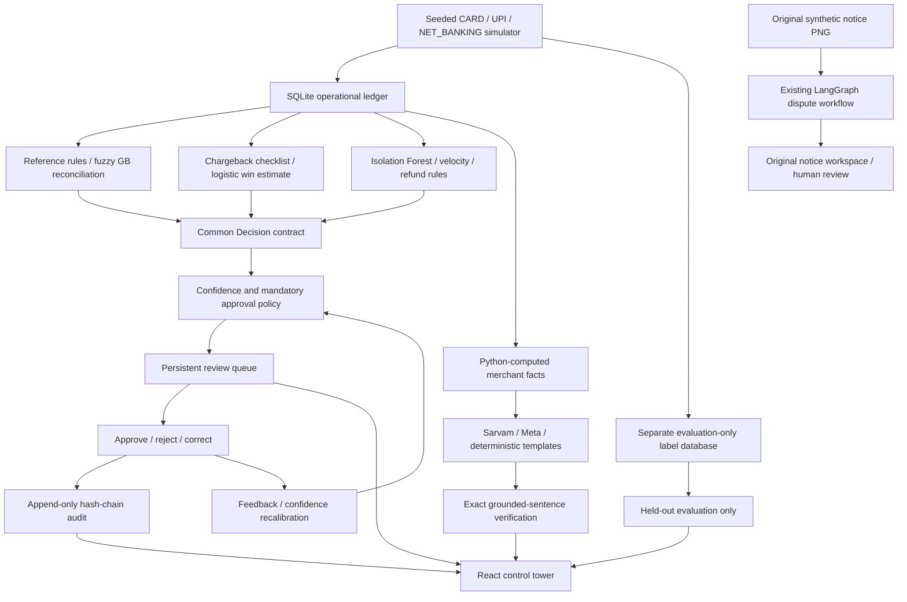

# PayOps Brain

## New synthetic operations extensions

Money Flow tracks authorization/clearing snapshots, matched settlement, refund and
dispute records. Historical authorization and clearing stages are explicitly
inferred synthetic snapshots, not observed bank events. Settlement comparisons
subtract expected fees, so clean transactions have no false gap. Pending exposure
and excess settlements are separate from realized loss. APIs:
`GET /api/money-flow/summary`, `GET /api/money-flow/{transaction_id}`.

Profit & Margin ranks synthetic merchant/rail/BIN fee revenue, actual fee cost,
potential leakage exposure and modeled net margin, with ledger reasons. Configure
new-payment rates with `SYNTHETIC_EARNED_FEE_BPS` (250) and
`SYNTHETIC_PAID_FEE_BPS` (200); existing contracts retain their snapshots. Missing
settlements remain pending, and realized dispute losses require explicit entries.
Fee Audit creates human-only RAISE_CLAIM suggestions with rail population z-scores
and sample counts. Margin explanations use the existing English/Hindi/Tamil fact gate.

Rupee Impact (`GET /api/impact`) separates observed exposure, label-validated
synthetic exposure, recorded synthetic recovery and model-expected dispute recovery.
It compares reconciliation review workload with rules-only and converts estimated
touches saved using `MINUTES_PER_ANALYST_TOUCH` (5). Per-100,000 scaling and all
assumptions are displayed. It does not treat approval as recovery or hours as measured
staff productivity. Only this reporting code may read the isolated synthetic labels.

Live Incidents generates append-only UPI bank outage, duplicate-settlement-file,
fee-rate-change and card-fraud-burst batches. `POST /api/incidents/{scenario}`
accepts an optional deterministic seed and batch size. Existing agents process
the batch; queue/activity polling reflects actual new decisions. These controls
change no bank, fee contract, routing policy or payment processing setting.

What-if Autonomy replays the original 512-transaction/608-case holdout at thresholds
0.70–0.99 via `GET /api/autonomy/replay?threshold=.95`. The slider and curve show
auto/review counts, false auto-resolutions and Wilson intervals. The replay uses
temporary data and a cached sample; it changes no ledger, policy or audit record.
All restricted actions remain human-only. New fee/routing agents are explicitly
excluded from this original three-agent denominator.

BIN & Routing groups synthetic token/BIN/issuer authorization results, declines,
disputes, fraud flags and fee cost. Fisher tests use explicit minimum sample sizes
and Bonferroni adjustment. Historical captured authorizations are inferred approved;
no external issuer telemetry is claimed. Contextual LinUCB learns success/cost from
separately seeded counterfactual route trials. `ROUTING_MIN_SAMPLES` (30) and
`ROUTING_MAX_TRAFFIC_SHIFT` (.10, at most .25) bound suggestions. Uplift during an
injected outage is a simulated weighted estimate, not a measured production gain.
ROUTING_CHANGE always requires expert human approval, which records advice only.

Earned Autonomy tracks type-level human review agreement separately from held-out
synthetic correctness, with counts and Wilson intervals. `AUTONOMY_QUALITY_FLOOR`
defaults to .95 and `AUTONOMY_MIN_REVIEWS` to 20. Assessments create POLICY_CHANGE
Decisions; approving one applies a version-checked type threshold to future cases.
More autonomy requires both quality lower bounds and sufficient reviews, and only
CLEAN bookkeeping is eligible. If measured quality drops after approval, assessment
automatically raises the threshold to .99 (safer), with an audit event. It never
automatically lowers a threshold or enables restricted actions. Historical cases
are unchanged. Review agreement is not proof of financial correctness.

Security adds a card-like pattern scan over the SQLite ledger, rejection of
unmasked card-like JSON input and defensive JSON response masking. Synthetic card
references are tokens or masked last-four values, including regenerated legacy
fixtures. Tests scan DB values, captured logs and API responses for standalone
13–19-digit card patterns (including spaces/hyphens), excluding decimal fractions
and embedded hashes/IDs. This is not PCI certification or comprehensive DLP.

Optional merchant speech is **off by default**. Set `PAYOPS_SARVAM_VOICE=true` in
the process environment to enable it when a Sarvam key exists and mock mode is off.
STT uses `saaras:v3`, multipart `/speech-to-text`, `language_code=unknown`; TTS uses
`bulbul:v3`, JSON `/text-to-speech`, `language_code`, WAV at 16 kHz. Configure
`SARVAM_STT_MODEL`, `SARVAM_TTS_MODEL`, `SARVAM_VOICE_BASE_URL` if needed. WAV
transcription is limited locally to 30 seconds. Spoken answers are regenerated
from ledger facts through the exact-sentence gate; arbitrary spoken financial
text cannot be supplied by the client. Audio is not persisted. The physical
microphone remains unverified; live loopback results, if run, are in
`reports/speech_check.json`. Opt in using `python scripts/check_sarvam_speech.py --live`.

The generated synthetic TTS→STT loopback passed English, Hindi and Tamil on
2026-11-15 with correct detected languages. This verifies a file-based provider
path, not a microphone, speaker playback, real-user speech quality or production
accuracy. Voice remains feature-flagged off unless explicitly enabled.

`make demo` now seeds all four repeatable incident types, runs the new agents,
queues autonomy proposals without applying them, and saves extension evaluation.
Open `/?view=Guided%20Demo` for links through every tested extension. `make eval`
also runs `scripts/eval_extensions.py`. See [two-minute demo](docs/DEMO_SCRIPT.md),
[extension measurements](reports/extensions_eval.md), and [phase log](docs/extensions.md).
New measured results on seed 916: 288/288 clean lifecycle checks, 96/96 injected
stage-gap detections, and 64/64 fee-discrepancy detections with no extra claims.
The report includes Wilson intervals and sample counts. A synthetic outage trial
proposes a 10% shift with about 6.37 percentage points of modeled uplift; no route
was changed, and no production gain is claimed.

**A synthetic payment operations control tower: one ledger, reviewable agents, human financial control.**

Paytm Build for India AI Hackathon - Track 3: Autonomous AI Teammates.
Built on the existing Meta dispute prototype. The original FastAPI routes,
LangGraph extraction/rules/redaction/draft/verifier and React notice workspace are
retained. The control tower adds persistent reconciliation, chargeback and fraud
cases, review feedback, multilingual merchant explanations and measured evaluation.
**No money moves, no arbitration is filed, and no payment processing is disabled.**

## Start with Docker

```sh
docker compose up --build
```

Open **http://localhost:8080**; backend docs: http://localhost:8000/docs.
Startup seeds the original 160 synthetic payments plus four repeatable incident
batches, runs the agents, and computes separate 512-transaction evaluations.
SQLite and audit history persist in `payops-data`.
The seed command is idempotent and never clears prior reviews or audit events.
Use a different simulator seed for another batch. `docker compose down` preserves
its volume. To avoid occupied ports set `BACKEND_PORT` / `FRONTEND_PORT` in the shell.

An absent `.env` works offline. Optional `.env` is passed at runtime, never baked
into either image. Backend runs as an unprivileged user. Use one backend process;
the simulator is a local in-process worker and original notice reviews are in memory.

## Local setup

Python 3.12 (validated) and Node 20.19+ or 22.12+ are required. PowerShell:

```powershell
python -m venv .venv
.\.venv\Scripts\python.exe -m pip install -r requirements.txt
# Only if .env does not already exist:
Copy-Item .env.example .env
.\.venv\Scripts\python.exe -m backend.demo
.\.venv\Scripts\python.exe -m uvicorn backend.main:app --host 127.0.0.1 --port 8000
```

In a second terminal:

```powershell
cd frontend
npm.cmd ci
npm.cmd run dev
```

Open **http://127.0.0.1:5173**. On Linux/macOS use `.venv/bin/python` and `npm`.
If `python` resolves to the Windows Store alias, select your installed interpreter
explicitly. Make targets assume an activated virtual environment:

| Command | Behavior |
|---|---|
| `make install` | Python dependencies and `npm ci` |
| `make test` | Pytest, original smoke, frontend build |
| `make seed` | Append/idempotently seed synthetic ledger |
| `make demo` | Seed, run agents, populate review queue and evaluation |
| `make eval` | Original 30-notice evaluation and control tower holdout |
| `make run` | FastAPI on 8000 |
| `make frontend` | Vite development frontend |

Equivalent commands work without Make, including on Windows.
`requirements.lock` records the versions validated in this build; Docker installs
that lock. Use `pip install -r requirements.lock` for the same Python dependency
versions locally. Node dependencies are pinned by `frontend/package-lock.json`.

## Architecture and stack



Python, FastAPI, Pydantic, LangGraph, standard-library SQLite, scikit-learn,
NumPy/Pandas, React 19, Vite, lucide-react, Pytest, Playwright, Docker Compose.
No authentication, external database or deployment platform was added.

### Agents

- **Reconciliation:** exact transaction reference first, normalized reference rule,
  then guarded fuzzy candidates scored by gradient boosting. Numeric reference
  identity, merchant, rail, amount, timing and ambiguity constrain candidates.
  A separately trained gradient-boosted break classifier is shown alongside
  deterministic ledger invariants. Both must agree before CLEAN auto-resolution.
- **Dispute:** UPI chargeback reason codes, weighted evidence checklist, deadlines,
  logistic synthetic win estimate, fight/accept recommendation and verified draft.
  Evidence confidence weights: reference .20, settlement .18, authentication .16,
  delivery .16, deadline .12, signed receipt .18. Signed receipt is explicitly
  unavailable. Complete available evidence therefore yields .82; missing evidence
  or an expired deadline reduces it. This score is not a win probability.
- **Fraud:** Isolation Forest plus merchant 60-second velocity, device risk,
  refund ratios and merchant amount deviations. Only review recommendations.
- **Original notice agent:** extract image → exact ledger match → demo rules →
  redact → structured draft → verify → additive intelligence summary. Its existing
  six-step trace and all original routes remain compatible.

### Decision and review policy

Every new agent returns `action`, `confidence`, `reasoning`, `evidence`, `amount`,
`case_id`. Amounts come from integer-paise ledger records and serialize as decimal
strings. Evidence must belong to the cited transaction. Confidence is validated
in [0,1] and is a synthetic-demo score.

| Configuration | Default |
|---|---|
| `AUTO_RESOLVE_THRESHOLD` | .95 |
| `HUMAN_REVIEW_THRESHOLD` | .70 |
| `HIGH_VALUE_THRESHOLD` | INR 50000 |
| `WRITE_OFF_LIMIT` | INR 5000 |

Eligible RECONCILE/NO_ACTION bookkeeping decisions at or above .95 auto-resolve.
Other cases at or above .70 require one-click review; lower scores go to the
expert queue. High-value cases, kill switches, restrictions, arbitration, policy
changes and write-offs above the limit always require expert review. High
confidence cannot override these gates. Human overrides record a corrected action
and reason; they never execute a financial operation.

Queue reviews use version checks and SQLite transactions. Predictions are retained;
feedback stores original/corrected decisions, reason, features and UTC time.
Recalibration fits logistic correctness confidence with a seeded synthetic prior
plus analyst feedback, reports separate holdout Brier scores and review estimates,
and applies to future predictions. Historical queues are not silently rewritten.
A lower review estimate is not proof of improved quality.

Audit insertion shares the business transaction. SQL triggers reject event
updates/deletes, and a SHA-256 chain detects tampering. Policy snapshots, provider
information, decisions, reviews, corrections, calibration, simulations and kill-switch
suggestions/approvals are recorded. A database administrator can rewrite the entire
chain; there is no external trusted checkpoint.

## Providers and credentials

Copy `.env.example` only when no local `.env` exists. Never commit populated keys.

```dotenv
LLM_PROVIDER=sarvam
SARVAM_API_KEY=
SARVAM_MODEL=sarvam-105b
SARVAM_BASE_URL=https://api.sarvam.ai/v1
SARVAM_TIMEOUT=30
PAYOPS_MOCK=false
```

Sarvam uses `/chat/completions` and `api-subscription-key`. Contract:
[Sarvam V1](https://docs.sarvam.ai/api-reference/chat/chat-completions-v1).
Sarvam-M is deprecated. `LLM_PROVIDER=meta` selects the retained Meta adapter;
`local`, missing credentials, or `PAYOPS_MOCK=true` uses deterministic templates.
Sarvam failures/rate limits/invalid output yield labeled local fallback, never a
fabricated success. A live Sarvam text check succeeded on 2026-11-15; ordinary tests
stub HTTP and never need keys.

Python computes money, counts and statuses. Providers compose supplied English,
Hindi or Tamil sentences; the output must be an exact permutation of those approved
sentences. Unsupported financial or nonfinancial claims are rejected. This is
constrained explanation, not unrestricted financial text generation. Unknown ledger
scope and timing predictions return: **"I'm not sure, routing to an analyst."**
Bulk agent batches use local drafts to avoid unsolicited provider costs. The case
file's **Generate provider draft** and merchant assistant call the configured provider.
Provider mode is shown in responses; configuration endpoints never expose keys.

The original image/draft adapters still support `MODEL_*`, per-step `EXTRACT_*`,
`DRAFT_*`, `REDACT_*`, and `BASETEN_*` overrides. Meta defaults to Responses and
`muse-spark-1.3`. Baseten redaction defaults to Chat and
`meta-models/muse-spark-open-1026`; the requested dashboard-specific ID remains
unverified. Without Baseten, original redaction can use the Meta model instead.
See [contract verification](docs/api_contracts.md).

Original offline extraction reads sidecar fields (**no OCR**); drafting is a
fixture, redaction is local scrubbing, and voice returns a labeled fixed transcript
that ignores speech content. Live errors in the original Meta graph escalate and
never silently fall back. A saved historical [live Meta report](eval_results_live.md)
is retained; it does not verify Baseten or real voice.

Original Muse Voice UI/upload remains available for compatibility. Live Muse Voice and a physical
microphone are unverified; do not present them as working speech recognition.
Supported audio: mono 16-bit PCM WAV, 16/24 kHz, at most 120 seconds / 10 MB.
Browser recordings convert to mono 24 kHz. No audio is persisted.

## Data and persistence

Only synthetic merchants, notices, transaction IDs and identifiers are generated.
`backend.simulator` appends deterministic batches and injects missing/short/duplicate
settlements, over-refunds, fee mismatches, chargebacks and fraud bursts.

Operational tables: `transactions`, `settlements`, `refunds`, `disputes`, `fees`,
`simulation_runs`, `merchant_profiles`, `agent_decisions`, `review_queue`,
`human_approvals`, `human_feedback`, `audit_events`, `model_registry`, `fraud_alerts`.
Initialization is additive (`CREATE IF NOT EXISTS`, schema version 1), with foreign
keys, indexed references and transaction boundaries. Default file:
`runtime/payops.sqlite3`; override with `PAYOPS_DB`.

`ground_truth_labels` lives in the sibling `payops.truth.sqlite3`. Only evaluation
code reads it; it has no API route. New agents never query labels during inference.
Original notice fixtures remain in `data/` and their offline evaluation is explicitly
fixture-assisted. The original 30-notice review session resets on backend restart;
unified ledger/review/audit history persists.

## API

New endpoints preserve their `/api` prefix. Vite/nginx strip it only for the
original `/health`, `/disputes` and `/notices` routes.

| Routes | Purpose |
|---|---|
| `GET /api/dashboard/summary` | Backend-computed metrics |
| `GET /api/transactions`, `/settlements`, `/merchants`, `/reconciliation` | Operational ledger/views |
| `POST /api/simulator/start`, `/stop`; `GET /api/simulator/status` | Batch or continuous simulation |
| `GET /api/agents`, `/agents/activity`; `POST /api/agents/run` | Agents/activity |
| `GET /api/review-queue`, `/{case_id}`, `/{case_id}/evidence` | Reviewable case files |
| `POST /api/review-queue/{case_id}/approve`, `/reject`, `/edit` | Versioned human decisions |
| `POST /api/review-queue/{case_id}/draft` | Explicit provider draft request |
| `POST /api/fraud/{case_id}/suggest-kill-switch`, `/approve-kill-switch` | Human-controlled suggestions |
| `GET /api/fraud/alerts`, `/audit`, `/feedback`, `/evaluation`, `/configuration` | Inspectable history/results |
| `POST /api/feedback/recalibrate`, `/evaluation/run` | Measured recalibration/evaluation |
| `POST /api/merchant-assistant/chat` | Merchant ID, language, question, optional transaction scope |

Original backend routes: `GET /health`, `/disputes`, `/disputes/{id}`,
`/notices/{id}.png`; `POST /disputes/{id}/run`, `/voice`, `/decision`, `/verify-demo`.
`run` accepts optional `note`; omission uses a prior voice transcript, explicit
empty string clears it for that run. Decisions require the latest `run_id`.
The bad-citation demonstration tests a copy without changing the reviewable result.
Original approval/rejection now also appends a persistent audit event.

## Tests and evaluation

```powershell
.\.venv\Scripts\python.exe -m pytest
.\.venv\Scripts\python.exe scripts/smoke.py
.\.venv\Scripts\python.exe scripts/check_api.py
.\.venv\Scripts\python.exe scripts/check_sarvam.py --require-live
.\.venv\Scripts\python.exe scripts/eval.py
.\.venv\Scripts\python.exe scripts/eval_control_tower.py
cd frontend
npm.cmd run build
npx.cmd playwright install chromium
# Start backend + Vite first; browser tests mutate synthetic review cases.
npx.cmd playwright test
```

`check_api.py --require-live --all` tests original Meta/Baseten credentials; optional
`--voice note.wav` checks voice. It must not be called a live success when a step
is mock. Default pytest forces mock mode and stubs external transports.

[Control tower report](reports/control_tower_eval.md): 512 held-out synthetic
transactions, 608 agent cases, seed 916. Training seeds and sample counts are in
the report; ground truth is consulted only by evaluation. Rules-only versus assisted:

| Metric | Rules-only | Assisted |
|---|---|---|
| Auto-match rate | 62.50% | 81.25% |
| Break accuracy | 68.75% | 100.00% |
| Dispute-win AUC (32 outcomes) | .5000 | .6745 |
| Fraud precision / recall | 50% / 100% | 50% / 100% |
| Human-review rate | 73.68% | 63.16% |
| Observed false auto-resolution | 0 / 160 | 0 / 224 |

Wilson intervals are included: zero observed false auto-resolutions does not prove
zero risk. Over-refund alerts count as false positives for the narrow injected-burst
fraud target. No fraud gain is claimed. Shared generator assumptions limit all
results. This does not benchmark OCR, model redaction or live-world performance.
Original [30-notice offline evaluation](eval_results.md) was rerun: 30/30 actions,
31/31 valid citations, 30/30 verifier passes, 12 escalations; fixture results are
not model accuracy. Feedback calibration scores are shown separately in the UI.

## Demo and known limits

Run `python -m backend.demo` or `make demo`, then follow the
[three-minute script](demo/script.md). The frontend has functional navigation for
Overview, Transactions, Reconciliation, Disputes, Fraud, Review Queue, Merchant
Assistant, AI Agents, Audit Trail and Evaluation. Metrics come from backend data.

This is a local, unauthenticated synthetic prototype. Do not enter real payment or
customer data. No production settlement/network integration, legal/network-specific
rules, real refunds, certified PII anonymization, authentication or deployment is
claimed. Redaction protects later draft context; original images/text go to the
configured extraction/redaction services. Hosted Baseten is not private hosting.
Live Meta/Baseten/Muse Voice entitlement remains unverified in this session.

Routing advice and the dedicated fee-audit agent are implemented in the extensions
above. KYC and credit agents remain **not implemented**.
ML models train from small synthetic priors and are rebuilt deterministically in
process; calibration parameters and feedback persist. The audit chain lacks an
external checkpoint. No demo video has been recorded.

See [implementation log](docs/implementation.md) and
[final implementation report](docs/implementation-report.md) for exact validation
commands, statuses and remaining limits.
